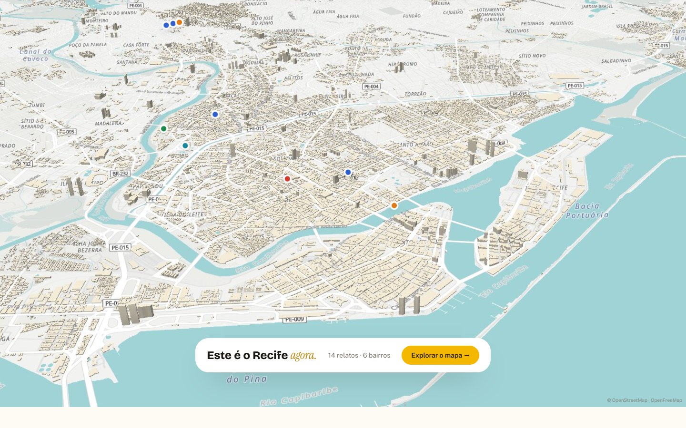

# Confluência

**Sua cidade tem voz.** Plataforma cívica para o Recife · React · TypeScript · Supabase

[](https://confluencia-liart.vercel.app)
[](https://react.dev)
[](https://www.typescriptlang.org)
[](https://supabase.com)
[](LICENSE)

O cidadão relata um problema no mapa, o relato ganha peso pela recorrência e pelos apoios, o órgão público responde em público, transforma o problema em projeto, abre uma consulta com voto secreto e auditável e publica a obra numa linha do tempo com prazos previstos e reais.

**No ar:** [confluencia-liart.vercel.app](https://confluencia-liart.vercel.app) · entre com as contas de demonstração da tela **Entrar**



> Projeto de disciplina do 4º período, feito por três pessoas. **Apresentação: 05/11/2026.**

## Sumário

- [O que faz](#o-que-faz)
- [Documentação](#documentação)
- [Stack](#stack)
- [Como rodar](#como-rodar)
- [Estrutura](#estrutura)
- [Time e processo](#time-e-processo)
- [Licença](#licença)

## O que faz

| Módulo | Para quem | O quê |
|---|---|---|
| **Feed** | Cidadão | Mapa 3D do Recife com os relatos; relatar com ponto no mapa; repercussão (recorrência + apoios); apoiar, comentar, seguir bairros; relato anônimo (sempre em Segurança); simulação ilustrativa de antes e depois |
| **Projetos** | Cidadão e órgão | Projetos por etapa; proposta, custo, fotos e linha do tempo com atrasos em dias; consulta pública com voto secreto, comprovante e verificação pública |
| **Painel** | Órgão verificado | Projetos do órgão, inclusive rejeitados; criar projeto ligado a um relato; publicar atualização; responder relatos oficialmente |
| **Perfil** | Todos | Uma página pública com relatos, respostas, projetos acompanhados, bairros seguidos e a conta |

O ciclo e os princípios estão em [Visão do produto](docs/visao-produto.md); cada tela, com capturas, no [Guia de uso](docs/guia-de-uso.md).

## Documentação

Índice completo em [`docs/README.md`](docs/README.md). Os principais:

| Documento | Conteúdo |
|---|---|
| [Visão do produto](docs/visao-produto.md) | Problema, público, ciclo, escopo do MVP |
| [Guia de uso](docs/guia-de-uso.md) | Cada tela e as contas de demonstração |
| [Arquitetura](docs/arquitetura.md) | Módulos, rotas, fluxo de dados, mapas, desempenho, segurança |
| [Banco de dados](docs/banco-de-dados.md) | Migrations, tabelas, funções, RLS e o que está aplicado |
| [Qualidade e testes](docs/qualidade.md) | O que foi verificado e os problemas em aberto |
| [Limitações e próximos passos](docs/limitacoes-e-proximos-passos.md) | O que o MVP não faz e o plano depois |
| [Contribuições](docs/contribuicoes.md) | Quem fez o quê, com evidência |

## Stack

- **React 19 + TypeScript + Vite 8**, rotas com React Router 7, carregadas sob demanda
- **Tailwind CSS v4** com os tokens do design system em `src/index.css`
- **MapLibre GL + deck.gl** no mapa do Feed (OpenFreeMap, sem chave de API)
- **GSAP** (landing e títulos) e **Framer Motion** (interface)
- **Supabase**: Postgres, Auth e Row Level Security; as regras sensíveis ficam no banco
- **Vercel**: deploy a cada merge na `main`, preview por PR

## Como rodar

```bash
git clone https://github.com/joaobatis1a/confluencia.git
cd confluencia
npm install
cp .env.example .env.local   # VITE_SUPABASE_URL e VITE_SUPABASE_ANON_KEY
npm run dev
```

Sem `.env.local`, Projetos funciona em modo demonstração (votação simulada); o Feed e o login precisam do banco. Para montar um banco do zero, aplique `supabase/migrations/0001` a `0009` em ordem (passo a passo em [`supabase/README.md`](supabase/README.md)).

| Comando | Faz |
|---|---|
| `npm run dev` | Servidor local |
| `npm run build` | Tipagem + build de produção |
| `npm run lint` | oxlint |

## Estrutura

```
src/
  pages/landing/       landing page
  pages/auth/          tela de Entrar
  features/feed/       módulo Feed (João)
  features/projetos/   módulo Projetos (Ana); api.ts concentra as consultas
  components/          barra, notificações, botão de relatar, UI
  context/             sessão (Supabase Auth)
  lib/                 cliente Supabase, repercussão, contas demo
  types/database.ts    contrato de dados
supabase/migrations/   esquema, RLS e funções (0001 a 0009)
docs/                  documentação
```

## Time e processo

| Pessoa | Frente | GitHub |
|---|---|---|
| João Batista (líder) | Frontend do Feed, geolocalização, visual | [@joaobatis1a](https://github.com/joaobatis1a) |
| Ana Beatriz | Frontend de Projetos, apoio ao banco | [@anabeatrizlsf](https://github.com/anabeatrizlsf) |
| Guilherme Araújo | Backend, autenticação, votação, deploy | [@guiaraujoo](https://github.com/guiaraujoo) |

Quatro semanas de desenvolvimento (07/10 a 01/11), três dias de folga e apresentação em 05/11 ([cronograma](docs/cronograma-atualizado.md)). A `main` é protegida: tudo entra por PR revisado ([ambiente colaborativo](docs/ambiente-colaborativo.md)).

## Licença

MIT, veja [`LICENSE`](LICENSE). Autoria conjunta de João Batista, Ana Beatriz e Guilherme Araújo.
