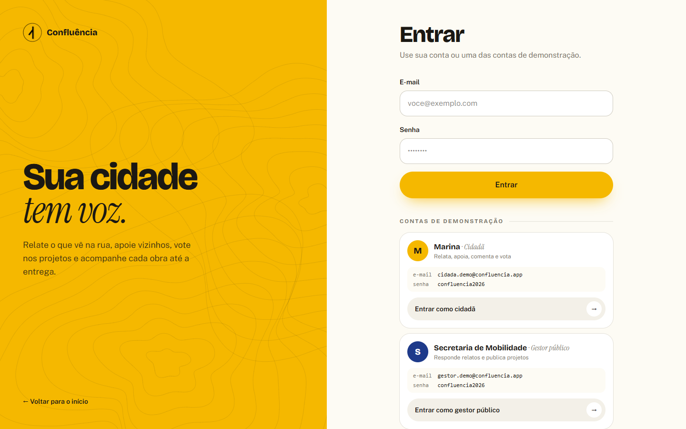
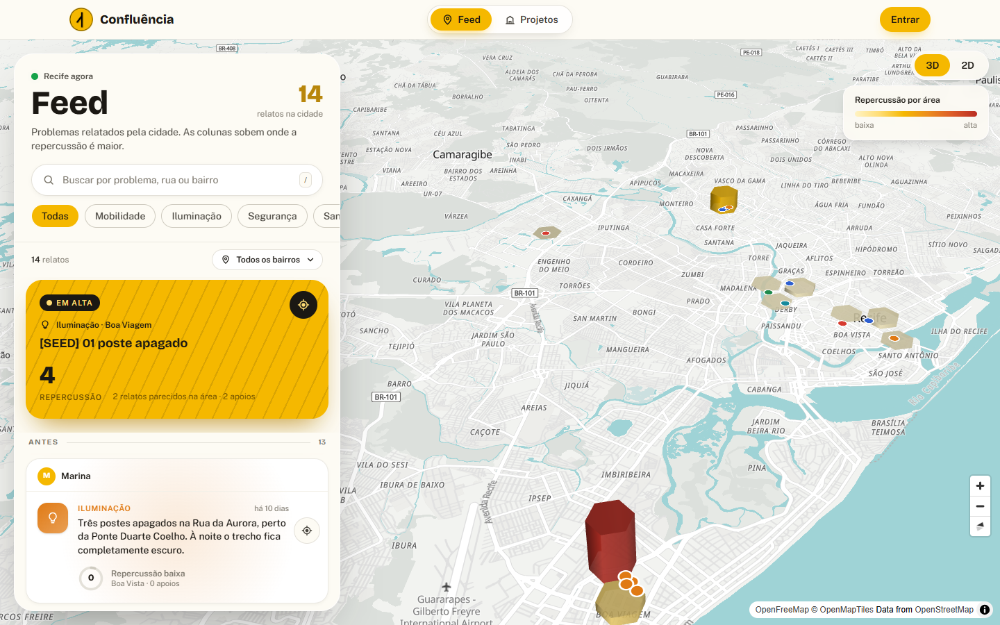
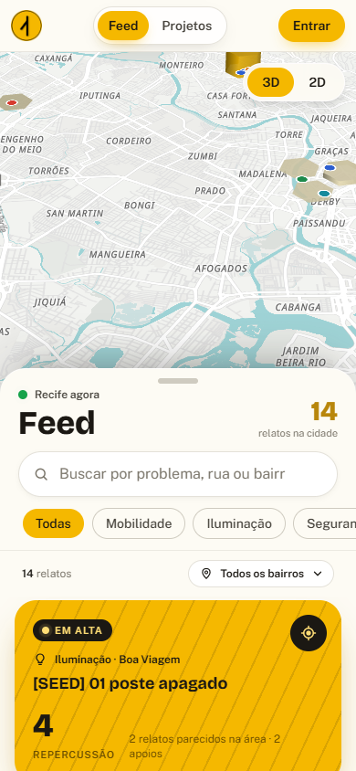
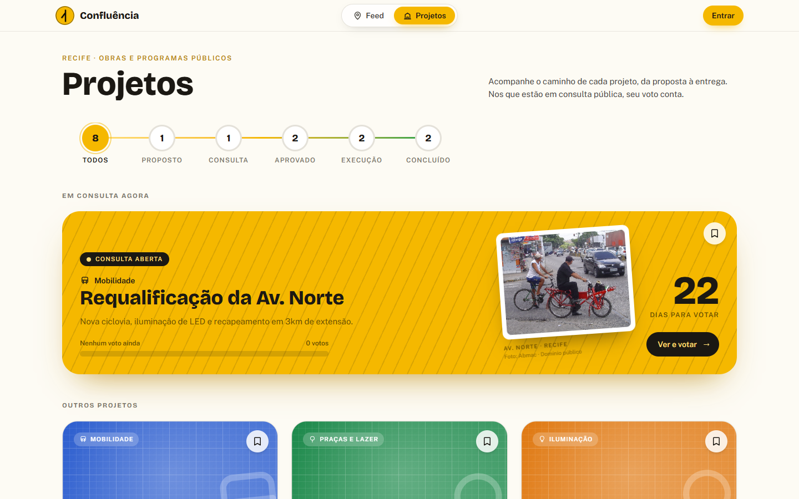
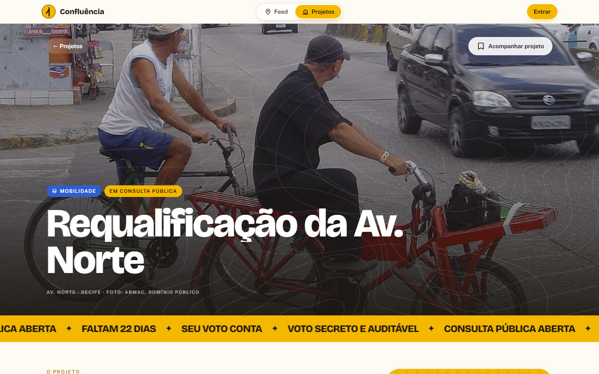
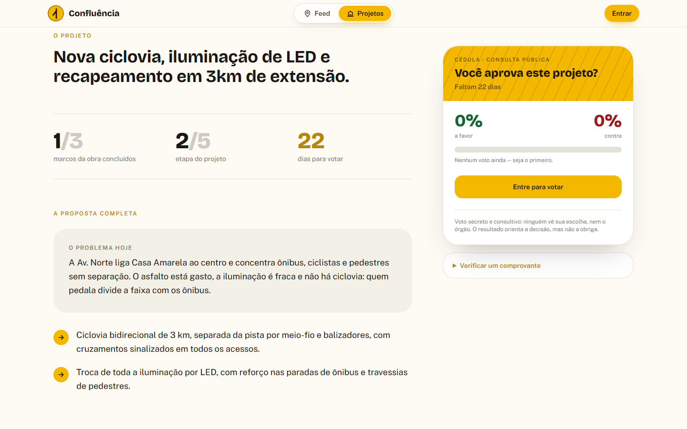
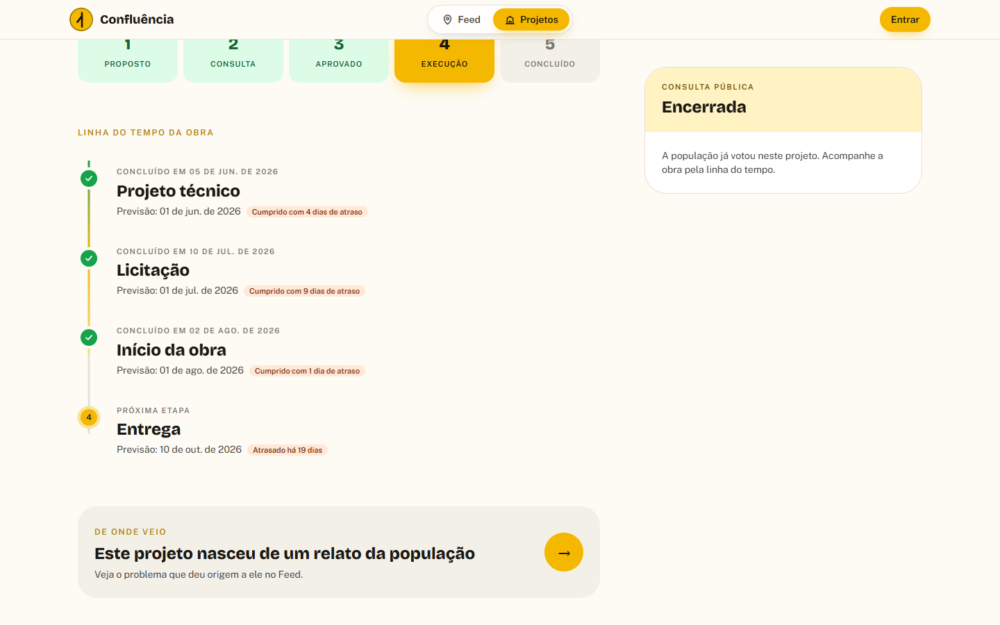
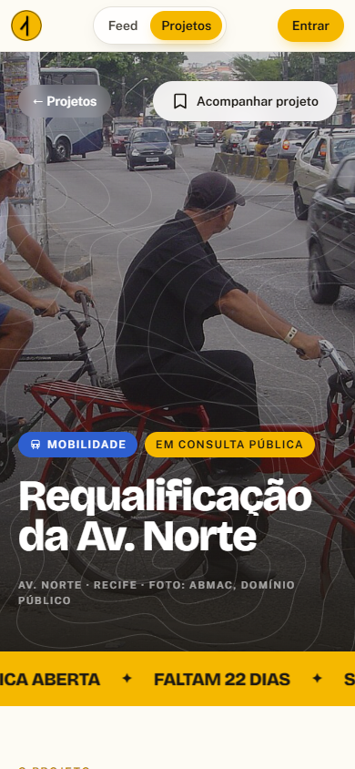

# Guia de uso

Passo a passo de cada tela, com capturas da produção ([confluencia-liart.vercel.app](https://confluencia-liart.vercel.app)) em 29/10/2026.

## Contas de demonstração

O cadastro está fechado no MVP. Para entrar, use uma das contas públicas de demonstração. A senha aparece na própria tela de Entrar.

| Conta | E-mail | Papel | Serve para |
|---|---|---|---|
| Marina | `cidada.demo@confluencia.app` | Cidadã | Relatar, apoiar, comentar, votar, seguir bairros |
| Secretaria de Mobilidade | `gestor.demo@confluencia.app` | Gestor público (institucional verificado) | Responder relatos, criar projetos, abrir consulta, publicar atualizações |

Sem entrar, dá para ver tudo o que é público: mapa, relatos, projetos, resultados e perfis.

## 1. Landing (`/`)

A primeira tela é só o título e uma janela com o Recife em 3D. Ao rolar, a janela abre até a cidade ocupar a tela, com os relatos reais como pontos no mapa.

Descendo, a página conta por que o projeto existe, como funciona em quatro passos (relate, apoie, vote, acompanhe), mostra um antes e depois da mesma rua (1855 e hoje), os números ao vivo e fotos da cidade. No fim, três crachás levam direto para o app como visitante, como Marina ou como Secretaria.

## 2. Entrar (`/entrar`)

Formulário de e-mail e senha, as duas contas de demonstração com o botão "Entrar como…" e o botão "Criar conta" desativado, com o aviso de que o cadastro abre depois do MVP. Se a pessoa já estiver conectada, a tela oferece continuar ou trocar de conta.

## 3. Feed (`/feed`)

O mapa ocupa a tela. No modo 3D, colunas hexagonais sobem onde a repercussão é maior (legenda no canto). No modo 2D, cada relato é um ponto com a cor da categoria.

No painel da esquerda:

- busca por problema, rua ou bairro (atalho `/`), com o termo destacado nos resultados
- filtro por categoria e por bairro
- o relato **Em alta** no topo e a lista dos demais
- o botão de mira leva o mapa até o relato

No celular, o painel vira uma gaveta que sobe de baixo para cima.

### Relatar um problema

Com a conta logada, o botão amarelo no canto inferior abre o formulário: categoria, bairro, descrição e o ponto no mapa (toque no mapa ou use "Minha localização"). O ponto precisa estar na Região Metropolitana do Recife. Em **Segurança**, o relato sai anônimo sempre; nas outras categorias, anonimato é opcional.

### Detalhe do relato (`/feed/:id`)

Descrição, autor (ou "Anônimo"), anel de repercussão, botão de apoiar, comentários, respostas oficiais dos órgãos e a simulação ilustrativa de "antes e depois" (arraste a divisória).

## 4. Projetos (`/projetos`)

O trilho no topo conta quantos projetos há em cada etapa e funciona como filtro. As consultas abertas aparecem em destaque, com os dias que faltam para votar e o placar parcial. Os demais projetos vêm em cartões por categoria. O marcador de cada cartão salva o projeto em **Acompanhando**.

### Detalhe do projeto (`/projetos/:id`)

Foto do local, nome, categoria e etapa. Embaixo: a proposta completa (problema, o que muda, estimativa de custo e prazo), fotos e vídeos de antes e depois quando existem, a etapa atual e a linha do tempo da obra.

**Votar:** na cédula da lateral, escolha "Sou a favor" ou "Sou contra" e confirme. O voto não pode ser trocado. Depois de votar, aparece o comprovante (16 caracteres). Ele continua aparecendo se você recarregar a página, mas a opção escolhida nunca aparece.

**Verificar um comprovante:** abaixo da cédula, cole o código. A resposta diz se o voto existe, em qual projeto e quando, sem dizer de quem é nem a opção.

**Linha do tempo:** cada marco mostra a data prevista e a real. Marco entregue depois do prazo mostra "Cumprido com X dias de atraso"; marco vencido e ainda aberto mostra "Atrasado há X dias". Quando o projeto nasceu de um relato, o cartão "De onde veio" leva até ele.

## 5. Painel do gestor (`/painel`)

Só para contas institucionais verificadas (entre como Secretaria de Mobilidade). Lista todos os projetos do órgão, inclusive os rejeitados (em vermelho, com o aviso de que não aparecem ao público), com os votos de cada um. Em cada projeto, **Publicar atualização** muda a etapa (ex.: de consulta para aprovado) e marca a data real dos marcos. **Novo projeto** (`/projetos/novo`) abre o formulário: nome, descrição, categoria, etapa inicial (proposto ou em consulta), fim da consulta, relato de origem e marcos previstos.

## 6. Perfil (`/u/:id`)

Um perfil só, público. Quem é o dono vê também a saudação, "Editar perfil" e "Sair". Abas:

| Aba | Mostra |
|---|---|
| Relatos | Os relatos da pessoa, agrupados por mês |
| Respostas | Para órgãos: as respostas oficiais publicadas |
| Acompanhando | Projetos salvos pelo marcador |
| Bairros | Bairros seguidos (relato novo num deles gera notificação) |
| Conta | Nome, apelido, bairro, bio e e-mail (só o dono vê) |

O menu da conta (avatar no canto) leva a **Meu perfil**, **Acompanhando** e, para gestores, **Painel**. O sino mostra as notificações: resposta oficial no seu relato, comentário, apoio e relato novo em bairro seguido.

## Glossário

| Termo | O que é |
|---|---|
| Relato | Problema urbano publicado no Feed, com categoria, bairro e ponto no mapa |
| Repercussão | Recorrência (relatos parecidos na área em 30 dias) + apoios. Baixa até 2, média de 3 a 5, alta a partir de 6 |
| Apoio | "Eu também tenho esse problema". Um por pessoa por relato |
| Resposta oficial | Mensagem de um órgão verificado no relato, com status |
| Consulta pública | Período em que o projeto aceita votos |
| Comprovante | Código gerado no banco no momento do voto; prova que o voto existe sem revelar a opção |
| Marco | Etapa da obra com data prevista e data real |
| Conta institucional | Conta de órgão público, aprovada manualmente pelo administrador |
